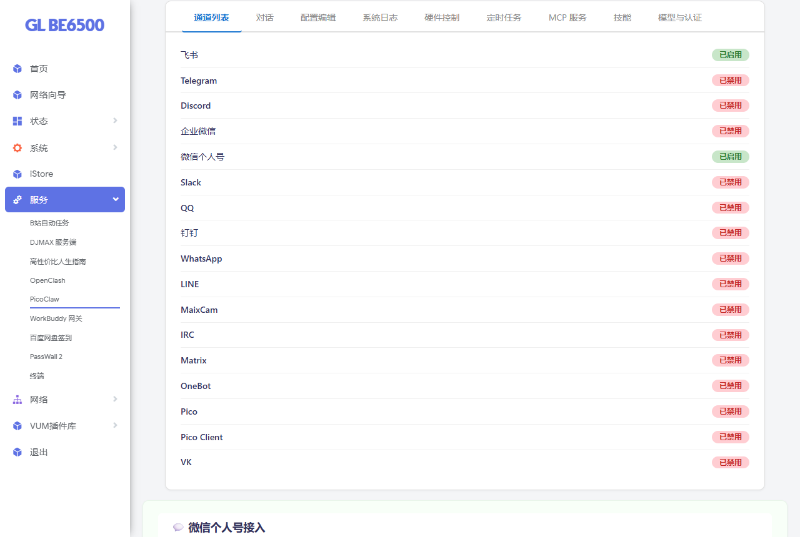
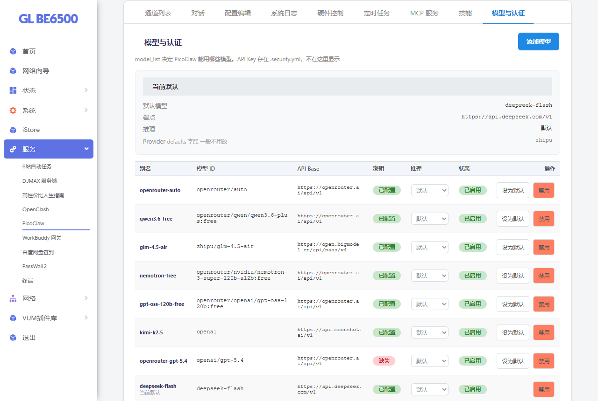
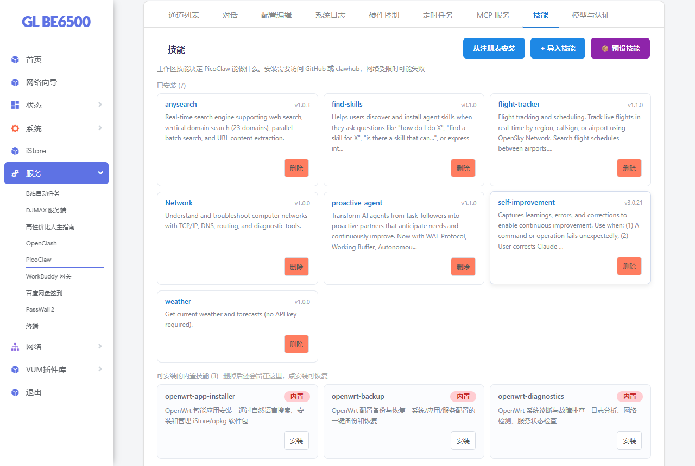
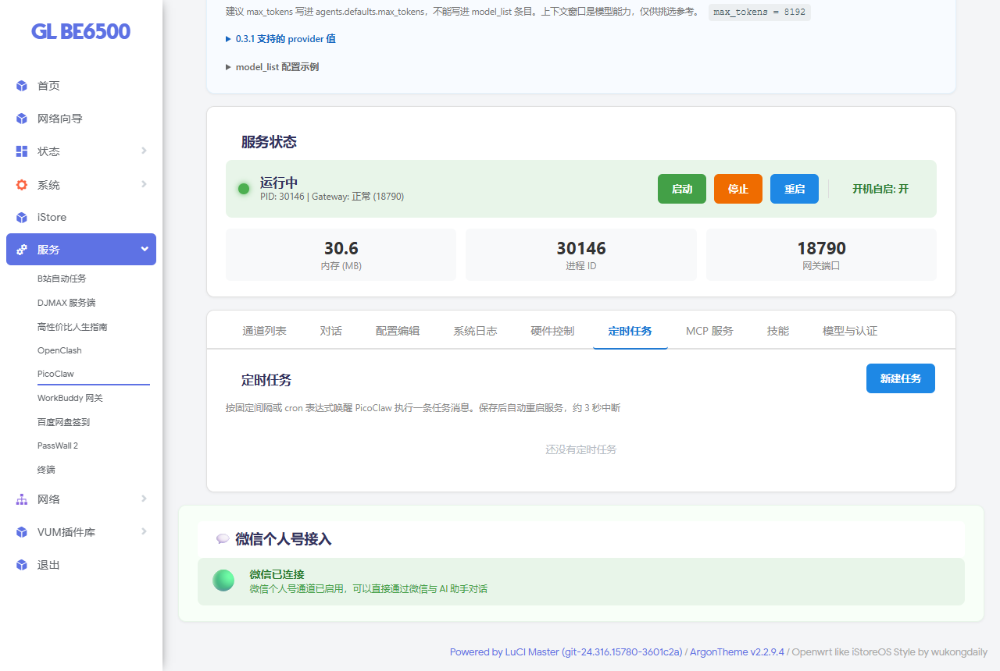

<p align="center">
  
</p>

<h1 align="center">luci-app-picoclaw</h1>

<p align="center">
  <b>Machen Sie Ihren Router zum AI-Assistenten — <a href="https://github.com/sipeed/picoclaw">PicoClaw</a> im Browser verwalten</b><br>
  <sub>Dienst · Channels · Modelle · Zeitpläne · MCP · Skills · Hardware</sub>
</p>

<p align="center">
  
  
  
</p>

<p align="center">
  <a href="README.md">English</a> ·
  <a href="README.zh.md">简体中文</a> ·
  <a href="README.ja.md">日本語</a> ·
  Deutsch ·
  <a href="README.pt.md">Português</a>
</p>

---

## Was ist das?

**[PicoClaw](https://github.com/sipeed/picoclaw)** ist ein KI-Assistent, der **auf deinem Router** läuft — er verbindet sich mit Sprachmodellen (DeepSeek, GLM, Qwen, OpenAI…) und chattet mit dir über Feishu, Telegram, Discord, WeChat und mehr.

PicoClaw selbst hat keine grafische Oberfläche — alles wird per Hand in JSON-Dateien konfiguriert. **Dieses Plugin ist diese Oberfläche**: eine LuCI-Seite, auf der du Dienst, Modelle, Channels, Zeitpläne, MCP-Server, Skills und Hardware direkt im Browser verwaltest. Kein SSH, kein handgeschriebenes JSON.

## ✨ Funktionen

Neun Tabs auf einer Seite:

| Tab | Was du damit machen kannst |
|---|---|
| **Channels** | Verbindungsstatus von Feishu / Telegram / Discord / WeChat … ansehen und umschalten |
| **Chat** | Mit dem Assistenten chatten, ohne die Router-Oberfläche zu verlassen |
| **Config Editor** | Geführtes Formular für `config.json`, plus roher JSON-Modus für Fortgeschrittene |
| **Logs** | PicoClaw-Ausgabe in Echtzeit — Fehler, LLM-Aufrufe, Token-Verbrauch |
| **Hardware** | Systeminfo, USB-Geräte, GPIO-Schalter |
| **Scheduled Tasks** | Cron-/Intervall-Jobs — anlegen, aktivieren, deaktivieren, löschen |
| **MCP Servers** | MCP-Server hinzufügen oder entfernen (stdio / http / sse) |
| **Skills** | Agent-Skills ansehen, installieren, importieren, löschen |
| **Models & Auth** | Modellliste, Standardmodell, Ein-/Ausschalten, API-Key-Status, Thinking Level |

Dazu ein-Klick-Start / Stopp / Neustart des Dienstes, Autostart, Suchmaschinen-Presets und ein JSON-Editor.

## 📋 Voraussetzungen

| | Details |
|---|---|
| **Router-Betriebssystem** | OpenWrt 21.02+ oder iStoreOS (mit LuCI-Oberfläche) |
| **PicoClaw-Binary** | Muss zuerst installiert werden — dieses Plugin ist nur das Web-UI, nicht PicoClaw selbst |
| **Architektur** | Alle (reines Lua, funktioniert auf allen Architekturen) |

## 🚀 Installation

### Schritt 1 — PicoClaw-Binary installieren

Dieses Plugin ist nur die Web-Oberfläche. PicoClaw selbst ist ein eigenes Programm — zuerst per SSH installieren:

```bash
cd /tmp
wget https://github.com/sipeed/picoclaw/releases/download/v0.3.1/picoclaw_Linux_x86_64.tar.gz
tar xzf picoclaw_Linux_x86_64.tar.gz
cp picoclaw /usr/bin/picoclaw && chmod +x /usr/bin/picoclaw
picoclaw --version
```

> ⚠️ Der Link ist für **x86_64**. ARM-Router (die meisten Xiaomi-, TP-Link-Geräte) brauchen `picoclaw_Linux_arm64.tar.gz` oder `picoclaw_Linux_armv7.tar.gz` — siehe [PicoClaw Releases](https://github.com/sipeed/picoclaw/releases). `uname -m` verrät dir die Architektur.

### Schritt 2 — Dieses Plugin installieren

**Option A — iStore** (am einfachsten)

iStore auf dem Router öffnen → `picoclaw` suchen → Install

**Option B — IPK** (OpenWrt mit `opkg`)

```bash
cd /tmp
wget https://github.com/GennKann/luci-app-picoclaw/releases/latest/download/luci-app-picoclaw_1.2.1-1_all.ipk
opkg install luci-app-picoclaw_1.2.1-1_all.ipk
rm -rf /tmp/luci-*   # LuCI-Cache leeren
```

**Option C — APK** (OpenWrt 25.x mit `apk`)

```bash
cd /tmp
wget https://github.com/GennKann/luci-app-picoclaw/releases/latest/download/luci-app-picoclaw-1.2.1-r1.apk
apk add --allow-untrusted luci-app-picoclaw-1.2.1-r1.apk
rm -rf /tmp/luci-*   # LuCI-Cache leeren
```

> Das APK ist nicht signiert, daher ist `--allow-untrusted` erforderlich.

**Aus dem Quellcode bauen**

```bash
# IPK (Systeme mit opkg)
python3 scripts/build-ipk.py

# APK v3 (OpenWrt 25.x / apk) — direkt auf dem Router ausführen
sh scripts/build-apk-v3.sh
```

> Windows-Klone: Mit aktivem `core.autocrlf` wandelt Git LF in CRLF um. Der Lua/HTML-Parser von LuCI akzeptiert nur LF (CRLF führt zu `unfinished string`) — vor dem Deploy `dos2unix` ausführen oder `git config core.autocrlf false` setzen.

### Schritt 3 — Öffnen

`http://<ROUTER-IP>/cgi-bin/luci/admin/services/picoclaw`

Dann ein Modell und einen API-Key hinterlegen — siehe [Modellkonfiguration](#-modellkonfiguration).

## 📸 Screenshots

| Channels | Models & Auth |
|:---:|:---:|
|  |  |

| Skills | Scheduled Tasks |
|:---:|:---:|
|  |  |

## 🤖 Modellkonfiguration

PicoClaw braucht einen **API-Key** (denk an ein Passwort) für mindestens einen Modellanbieter.

**Schnellster Weg — über die Oberfläche:**

1. Tab **Models & Auth** öffnen
2. **Add model** klicken und ein Preset wählen (DeepSeek / Zhipu GLM / Qwen / OpenAI / Anthropic / OpenRouter / Ollama) — API-Base und Modell-ID werden automatisch eingetragen
3. **API-Key** einfügen
4. **Set as default** klicken, dann **Save**

**Oder über die Konsole** (der Key landet nicht in `config.json`):

```bash
picoclaw model add -b https://api.deepseek.com/v1 -k sk-xxx -m deepseek-flash -n deepseek-flash
picoclaw model deepseek-flash        # als Standard setzen
```

> 🔒 Im UI eingegebene Keys landen in Picoclaws `.security.yml`, nicht in `config.json`.

**Thinking Level** — jede Modellzeile hat ein Dropdown (default / low / medium / high / max / adaptive), das auf `thinking_level` abbildet. Ob es die Antwort wirklich verändert, hängt vom Anbieter ab: DeepSeek akzeptiert low/high/max, manche Anbieter nur `adaptive`, nicht unterstützte Werte fallen auf den Standard zurück.

**Woher der Key?** [Zhipu](https://open.bigmodel.cn/) · [DeepSeek](https://platform.deepseek.com/) · [OpenRouter](https://openrouter.ai/) — alle drei geben bei der Registrierung Gratis-Credits.

## 🔍 Suchmaschine

PicoClaw kann das Web durchsuchen, um Fragen zu beantworten. Für Nutzer in China empfehlen wir GLM Search oder Baidu:

| Engine | China | Hinweise |
|---|:---:|---|
| GLM Search | ✅ | Empfohlen, funktioniert in China |
| Baidu | ✅ | Alternative |
| DuckDuckGo / Brave / Tavily / Perplexity | ❌ | GFW-blockiert, nur im Ausland |
| SearXNG | ⚠️ | Self-hosted, abhängig vom Standort |

## ❓ FAQ

| Frage | Antwort |
|---|---|
| Seite lädt nicht nach Installation? | PicoClaw-Binary zuerst installieren (Schritt 1) — dieses Plugin ist nur das Web-UI |
| KI sagt „keine Internetberechtigung"? | Suchmaschine ist blockiert — auf GLM Search oder Baidu umstellen |
| In iStore nicht gefunden? | `opkg update` ausführen oder IPK von Releases laden |
| API-Key-Feld zeigt `[NOT_HERE]`? | Normal — echte Keys in `.security.yml`, über LuCI UI verwalten |
| Was ist ein API-Key? | Ein Passwort für den Aufruf von KI-Diensten. Auf der Anbieter-Website registrieren — die meisten bieten kostenlose Credits |
| Router-Architektur prüfen? | Per SSH `uname -m` ausführen. Häufige Werte: x86_64, aarch64, mipsel |
| OpenWrt 25.x installiert das IPK nicht? | 25.x nutzt `apk` statt `opkg` — nimm das `.apk` und `apk add --allow-untrusted` |
| Beim Speichern erscheint "unknown field(s)"? | PicoClaw 0.3.1 prüft `config.json` streng. Erlaubt sind nur `model_name`, `provider`, `model`, `api_base`, `api_keys`, `enabled`, `thinking_level` — `max_tokens` gehört nach `agents.defaults` |

## Changelog

Siehe [CHANGELOG.md](CHANGELOG.md).

## 📄 Lizenz

[MIT License](LICENSE)

---

Support
-------

Wenn Ihnen dieses Projekt gefällt, können Sie dem Repository einen Stern geben oder mir einen Kaffee spendieren :)

[](https://ko-fi.com/gennkann)

<details>
<summary>🇨🇳 WeChat Pay</summary>

</details>
