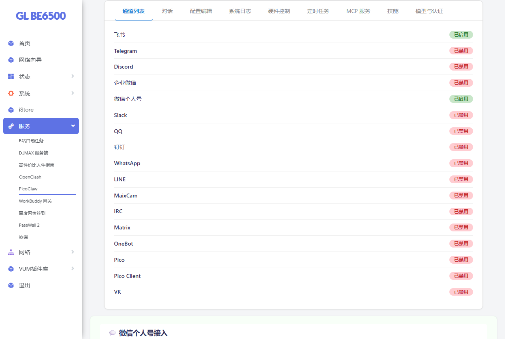
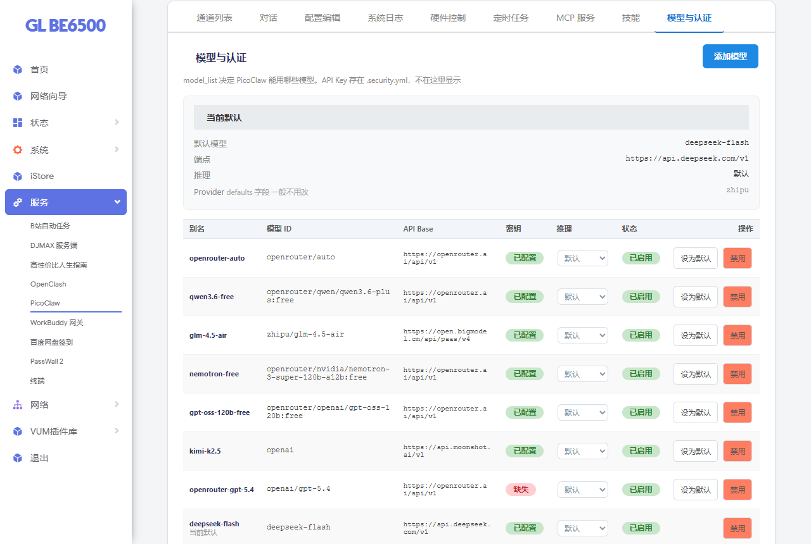
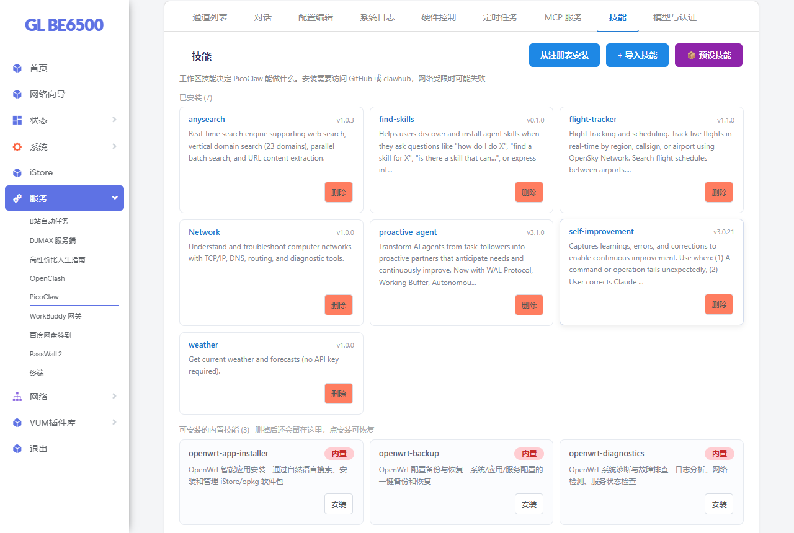
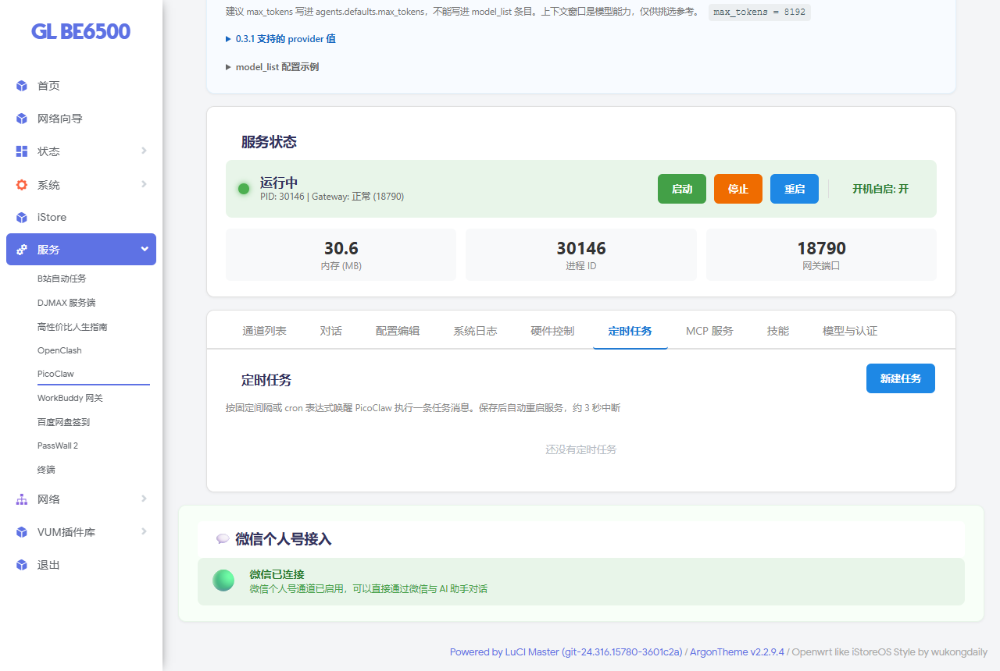

<p align="center">
  
</p>

<h1 align="center">luci-app-picoclaw</h1>

<p align="center">
  <b>ルーターをAIアシスタントに — ブラウザで<a href="https://github.com/sipeed/picoclaw">PicoClaw</a>を管理</b><br>
  <sub>サービス · チャンネル · モデル · 定期実行ジョブ · MCP · スキル · ハードウェア</sub>
</p>

<p align="center">
  
  
  
</p>

<p align="center">
  <a href="README.md">English</a> ·
  <a href="README.zh.md">简体中文</a> ·
  日本語 ·
  <a href="README.de.md">Deutsch</a> ·
  <a href="README.pt.md">Português</a>
</p>

---

## これは何？

**[PicoClaw](https://github.com/sipeed/picoclaw)** は、**ルーター上で**動くAIアシスタントです。大規模言語モデル（DeepSeek、GLM、Qwen、OpenAIなど）に接続し、Feishu、Telegram、Discord、WeChatなどでチャットできます。

PicoClaw自体にGUIはなく、設定はすべてJSONを手で編集する方式でした。**このプロジェクトがそのUI** — サービス、モデル、チャンネル、定期実行ジョブ、MCPサーバー、スキル、ハードウェアをすべてブラウザから操作できます。SSHもJSON手編集も不要です。

## ✨ 機能

1ページに9つのタブ:

| タブ | できること |
|---|---|
| **チャンネル** | Feishu / Telegram / Discord / WeChatなどの接続状態の確認とON/OFF |
| **チャット** | ルーターの管理画面からそのままAIと会話 |
| **設定エディタ** | `config.json` をフォームで編集、上級者は生JSONモードも |
| **ログ** | PicoClawのリアルタイム出力 — エラー、LLM呼び出し、token使用量 |
| **ハードウェア** | システム情報、USBデバイス、GPIO切替 |
| **定期実行ジョブ** | cron / 間隔ジョブ — 作成・有効化・無効化・削除 |
| **MCPサーバー** | MCPサーバーの追加・削除（stdio / http / sse） |
| **スキル** | Agentスキルの閲覧・インストール・インポート・削除 |
| **モデルと認証** | モデル一覧、デフォルトモデル、有効/無効、APIキーの状態、thinking level |

加えてサービスのワンクリック起動/停止/再起動、自動起動設定、検索エンジンのプリセット、上級者向けJSONエディタを備えています。

## 📋 動作要件

| | 詳細 |
|---|---|
| **ルーターOS** | OpenWrt 21.02+ または iStoreOS（LuCIインターフェース付き） |
| **PicoClawバイナリ** | 先にインストール必須 — このプラグインはWeb UIのみ、PicoClaw自体ではありません |
| **アーキテクチャ** | 全アーキテクチャ対応（純粋Lua） |

## 🚀 インストール

### ステップ1: PicoClaw本体のインストール

このプラグインはWeb UIのみです。PicoClaw本体は別のプログラムなので、先にSSHでインストールします:

```bash
cd /tmp
wget https://github.com/sipeed/picoclaw/releases/download/v0.3.1/picoclaw_Linux_x86_64.tar.gz
tar xzf picoclaw_Linux_x86_64.tar.gz
cp picoclaw /usr/bin/picoclaw && chmod +x /usr/bin/picoclaw
picoclaw --version
```

> ⚠️ 上のリンクは **x86_64** 用です。ARMルーター（Xiaomi、TP-Linkの多く）は `picoclaw_Linux_arm64.tar.gz` または `picoclaw_Linux_armv7.tar.gz` が必要です — [PicoClaw Releases](https://github.com/sipeed/picoclaw/releases) で確認してください。`uname -m` で調べられます。

### ステップ2: このプラグインのインストール

**方法A: iStore**（最も簡単）

ルーター管理画面でiStoreを開き、`picoclaw` を検索 → Install

**方法B: IPK**（`opkg` を使うOpenWrt）

```bash
cd /tmp
wget https://github.com/GennKann/luci-app-picoclaw/releases/latest/download/luci-app-picoclaw_1.2.0-1_all.ipk
opkg install luci-app-picoclaw_1.2.0-1_all.ipk
rm -rf /tmp/luci-*   # LuCIキャッシュをクリア
```

**方法C: APK**（OpenWrt 25.x の `apk` システム）

```bash
cd /tmp
wget https://github.com/GennKann/luci-app-picoclaw/releases/latest/download/luci-app-picoclaw-1.2.0-r1.apk
apk add --allow-untrusted luci-app-picoclaw-1.2.0-r1.apk
rm -rf /tmp/luci-*   # LuCIキャッシュをクリア
```

> APKは未署名のため、`--allow-untrusted` が必要です。

**ソースからビルド**

```bash
# IPK（opkgシステム）
python3 scripts/build-ipk.py

# APK v3（OpenWrt 25.x / apkシステム）— ルーター上で直接実行
sh scripts/build-apk-v3.sh
```

> Windowsでcloneした場合：`core.autocrlf` が有効ならGitがLFをCRLFに変換します。LuCIのLua/HTMLパーサはLFのみ受付（CRLFは `unfinished string` になります）。配置前に `dos2unix` を実行するか `git config core.autocrlf false` を設定してください。

### ステップ3: 開く

`http://<ルーターIP>/cgi-bin/luci/admin/services/picoclaw`

モデルとAPIキーを追加すれば使えます — [モデル設定](#-モデル設定) を参照。

## 📸 スクリーンショット

| チャンネル | モデルと認証 |
|:---:|:---:|
|  |  |

| スキル | 定期実行ジョブ |
|:---:|:---:|
|  |  |

## 🤖 モデル設定

PicoClawには少なくとも1つのモデルプロバイダーの **APIキー**（パスワードのようなもの）が必要です。

**最速の方法 — UIから:**

1. **モデルと認証** タブを開く
2. **モデルを追加** をクリックし、プリセット（DeepSeek / Zhipu GLM / Qwen / OpenAI / Anthropic / OpenRouter / Ollama）を選ぶ — API Base とモデルIDは自動入力されます
3. **APIキー** を貼り付け
4. **デフォルトに設定** をクリックして **保存**

**またはターミナルから**（キーが `config.json` に入りません）:

```bash
picoclaw model add -b https://api.deepseek.com/v1 -k sk-xxx -m deepseek-flash -n deepseek-flash
picoclaw model deepseek-flash        # デフォルトに設定
```

> 🔒 UIで入力したキーは `config.json` ではなく PicoClaw の `.security.yml` に保存されます。

**thinking level** — 各モデル行にドロップダウン（default / low / medium / high / max / adaptive）があり、`thinking_level` に対応します。実際の出力に影響するかはプロバイダ次第です。DeepSeekは low/high/max に対応しますが、他のプロバイダは adaptive のみ受付ることが多く、対応外の値はデフォルトにフォールバックします。

**キーの入手先**: [Zhipu](https://open.bigmodel.cn/) · [DeepSeek](https://platform.deepseek.com/) · [OpenRouter](https://openrouter.ai/) — いずれも登録で無料クレジットがもらえます。

## 🔍 検索エンジン

PicoClawはウェブ検索で質問に答えることができます。中国国内のユーザーにはGLM SearchまたはBaiduを推奨：

| エンジン | 中国国内 | 備考 |
|---|:---:|---|
| GLM Search | ✅ | 推奨、中国国内で利用可能 |
| Baidu | ✅ | 代替 |
| DuckDuckGo / Brave / Tavily / Perplexity | ❌ | GFWでブロック、海外のみ |
| SearXNG | ⚠️ | セルフホスト、デプロイ場所による |

## ❓ FAQ

| 質問 | 回答 |
|---|---|
| インストール後ページが読み込まれない？ | PicoClawバイナリを先にインストール（ステップ1） — このプラグインはWeb UIのみ |
| AIが「インターネットアクセス権がない」と言う？ | 検索エンジンがブロックされています — GLM SearchまたはBaiduに切替 |
| iStoreで見つからない？ | `opkg update`を実行して更新、またはReleasesからIPKをダウンロード |
| APIキー欄に`[NOT_HERE]`と表示？ | 正常 — 実際のキーは`.security.yml`にあり、LuCI UIで管理 |
| APIキーとは？ | AIサービスを呼び出すためのパスワードのようなもの。プロバイダーのサイトで登録して取得 — ほとんどは無料クレジットあり |
| ルーターのアーキテクチャ確認方法は？ | SSH接続して`uname -m`を実行。よくある値：x86_64, aarch64, mipsel |
| OpenWrt 25.x でIPKが入らない？ | 25.xは `opkg` ではなく `apk` を使います。`.apk` をダウンロードして `apk add --allow-untrusted` |
| 設定保存で "unknown field(s)" と表示される？ | PicoClaw 0.3.1 は `config.json` を厳格に検証します。使えるのは `model_name`、`provider`、`model`、`api_base`、`api_keys`、`enabled`、`thinking_level` のみ。`max_tokens` は `agents.defaults` に置いてください |

## 変更履歴

[CHANGELOG.md](CHANGELOG.md)を参照。

## 📄 ライセンス

[MIT License](LICENSE)

---

Support
-------

このプロジェクトが気に入ったら、リポジトリにスターを付けたり、コーヒーをおごっていただけると嬉しいです :)

[](https://ko-fi.com/gennkann)

<details>
<summary>🇨🇳 WeChat Pay</summary>

</details>
