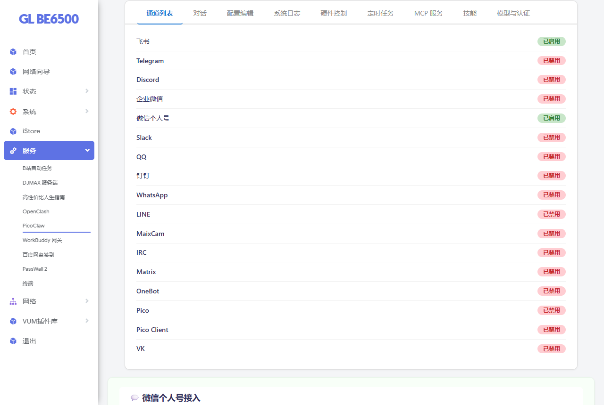
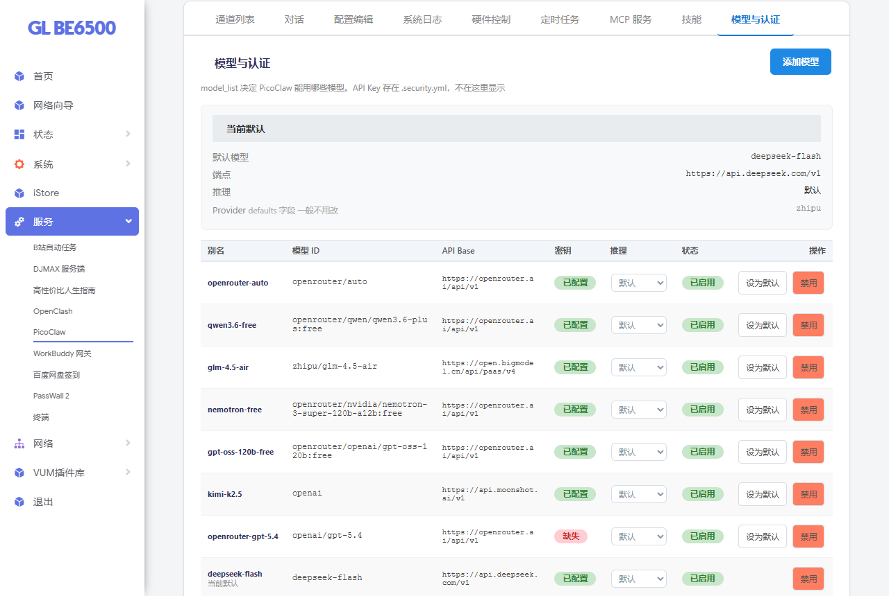
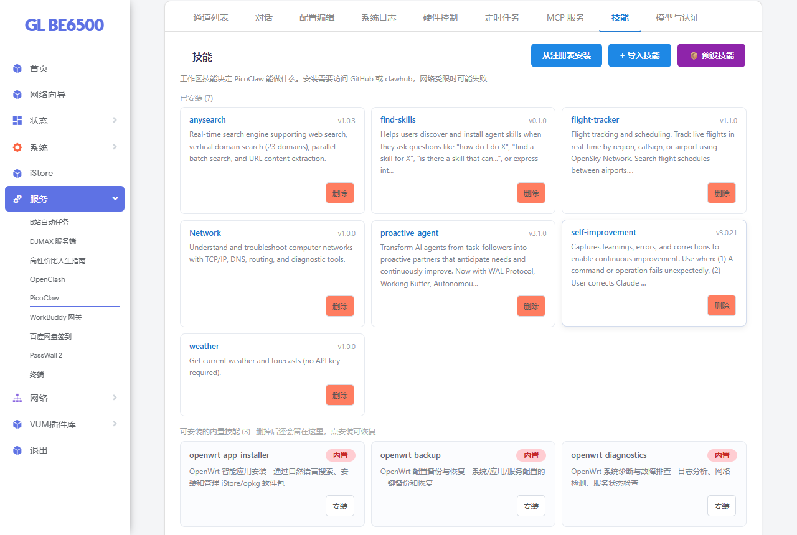
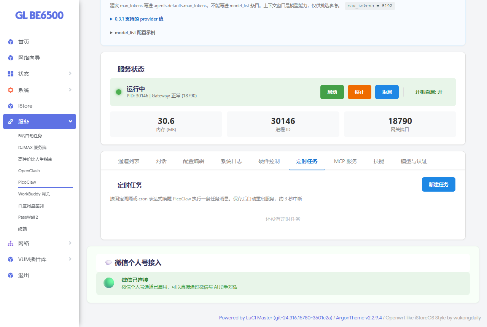

<p align="center">
  
</p>

<h1 align="center">luci-app-picoclaw</h1>

<p align="center">
  <b>Turn your router into an AI assistant — manage <a href="https://github.com/sipeed/picoclaw">PicoClaw</a> from your browser</b><br>
  <sub>Service · Channels · Models · Scheduled tasks · MCP · Skills · Hardware</sub>
</p>

<p align="center">
  
  
  
</p>

<p align="center">
  English ·
  <a href="README.zh.md">简体中文</a> ·
  <a href="README.ja.md">日本語</a> ·
  <a href="README.de.md">Deutsch</a> ·
  <a href="README.pt.md">Português</a>
</p>

---

## What is this?

**[PicoClaw](https://github.com/sipeed/picoclaw)** is an AI assistant that runs **on your router** — it connects to large language models (DeepSeek, GLM, Qwen, OpenAI…) and chats with you over Feishu, Telegram, Discord, WeChat and more.

PicoClaw itself has no graphical interface — everything is configured by hand in JSON files. **This plugin is that interface**: one LuCI page where you manage the service, models, channels, scheduled tasks, MCP servers, skills and hardware straight from the browser. No SSH, no hand-edited JSON.

## ✨ Features

Nine tabs on a single page:

| Tab | What you can do |
|---|---|
| **Channels** | See and toggle Feishu / Telegram / Discord / WeChat … connection status |
| **Chat** | Talk to your assistant without leaving the router's web UI |
| **Config Editor** | Guided form for `config.json`, plus a raw JSON mode for advanced tweaks |
| **Logs** | Live PicoClaw output — errors, LLM calls, token usage |
| **Hardware** | System info, USB devices, GPIO toggles |
| **Scheduled Tasks** | Cron / interval jobs — create, enable, disable, delete |
| **MCP Servers** | Add or remove MCP servers (stdio / http / sse) |
| **Skills** | Browse, install, import and delete agent skills |
| **Models & Auth** | Model list, default model, enable/disable, API key status, thinking level |

Plus one-click service start / stop / restart, boot-on-start, search engine presets, and a JSON editor.

## 📋 Requirements

| | Details |
|---|---|
| **Router OS** | OpenWrt 21.02+ or iStoreOS (with LuCI interface) |
| **PicoClaw binary** | Must be installed first — this plugin is only the web UI, not PicoClaw itself |
| **Architecture** | Any (pure Lua, works on all architectures) |

## 🚀 Installation

### Step 1 — Install the PicoClaw binary

This plugin is only the web UI. PicoClaw itself is a separate program — install it first over SSH:

```bash
cd /tmp
wget https://github.com/sipeed/picoclaw/releases/download/v0.3.1/picoclaw_Linux_x86_64.tar.gz
tar xzf picoclaw_Linux_x86_64.tar.gz
cp picoclaw /usr/bin/picoclaw && chmod +x /usr/bin/picoclaw
picoclaw --version
```

> ⚠️ That link is **x86_64**. ARM routers (most Xiaomi, TP-Link) need `picoclaw_Linux_arm64.tar.gz` or `picoclaw_Linux_armv7.tar.gz` — see [PicoClaw Releases](https://github.com/sipeed/picoclaw/releases). Run `uname -m` to find out which one you have.

### Step 2 — Install this plugin

**Option A — iStore** (easiest)

Open iStore on your router → search `picoclaw` → click Install

**Option B — IPK** (OpenWrt with `opkg`)

```bash
cd /tmp
wget https://github.com/GennKann/luci-app-picoclaw/releases/latest/download/luci-app-picoclaw_1.2.1-1_all.ipk
opkg install luci-app-picoclaw_1.2.1-1_all.ipk
rm -rf /tmp/luci-*   # clear the LuCI cache
```

**Option C — APK** (OpenWrt 25.x with `apk`)

```bash
cd /tmp
wget https://github.com/GennKann/luci-app-picoclaw/releases/latest/download/luci-app-picoclaw-1.2.1-r1.apk
apk add --allow-untrusted luci-app-picoclaw-1.2.1-r1.apk
rm -rf /tmp/luci-*   # clear the LuCI cache
```

> The APK is unsigned, so `--allow-untrusted` is required.

**Building from source**

```bash
# IPK (opkg systems)
python3 scripts/build-ipk.py

# APK v3 (OpenWrt 25.x / apk systems) — run on the router itself
sh scripts/build-apk-v3.sh
```

> Windows clones: if `core.autocrlf` is enabled, Git converts LF to CRLF on checkout.
> LuCI's Lua/HTML parser only accepts LF (CRLF causes `unfinished string`), so run
> `dos2unix` on the files you deploy, or set `git config core.autocrlf false`.

### Step 3 — Open it

`http://<ROUTER_IP>/cgi-bin/luci/admin/services/picoclaw`

Then add a model and an API key — see [Model Configuration](#-model-configuration).

## 📸 Screenshots

| Channels | Models & Auth |
|:---:|:---:|
|  |  |

| Skills | Scheduled Tasks |
|:---:|:---:|
|  |  |

## 🤖 Model Configuration

PicoClaw needs an **API key** (think of it as a password) for at least one model provider.

**Fastest way — the UI:**

1. Open the **Models & Auth** tab
2. Click **Add model** and pick a preset (DeepSeek / Zhipu GLM / Qwen / OpenAI / Anthropic / OpenRouter / Ollama) — API base and model ID are filled in for you
3. Paste your **API key**
4. Click **Set as default**, then **Save**

**Or from the terminal** (keeps the key out of `config.json`):

```bash
picoclaw model add -b https://api.deepseek.com/v1 -k sk-xxx -m deepseek-flash -n deepseek-flash
picoclaw model deepseek-flash        # set as default
```

> 🔒 Keys entered in the UI are written to PicoClaw's `.security.yml`, not into `config.json`.

**Thinking level** — every model row has a dropdown (default / low / medium / high / max / adaptive) mapped to `thinking_level`. Whether it actually changes the answer depends on the provider: DeepSeek honours low/high/max, some vendors only accept `adaptive`, and unsupported values fall back to the default.

**Where to get a key:** [Zhipu](https://open.bigmodel.cn/) · [DeepSeek](https://platform.deepseek.com/) · [OpenRouter](https://openrouter.ai/) — all three hand out free credits on signup.

## 🔍 Search Engine

PicoClaw can search the web to answer questions. For users in China, we recommend GLM Search or Baidu:

| Engine | China | Notes |
|---|:---:|---|
| GLM Search | ✅ | Recommended, works in China |
| Baidu | ✅ | Alternative |
| DuckDuckGo / Brave / Tavily / Perplexity | ❌ | Blocked by GFW, works overseas |
| SearXNG | ⚠️ | Self-hosted, depends on where it's deployed |

## ❓ FAQ

| Question | Answer |
|---|---|
| Page doesn't load after install? | Install the PicoClaw binary first (Step 1) — this plugin is just the web UI |
| AI says "no permission to access internet"? | Search engine is blocked — switch to GLM Search or Baidu |
| Can't find in iStore? | Run `opkg update` to refresh, or download the IPK from Releases |
| API key field shows `[NOT_HERE]`? | That's normal — real keys are in `.security.yml`, managed via the LuCI UI |
| What is an API Key? | It's like a password for calling AI services. Register on the provider's site to get one — most offer free credits |
| How to check router architecture? | SSH in and run `uname -m`. Common values: x86_64, aarch64, mipsel |
| OpenWrt 25.x refuses the IPK? | 25.x uses `apk`, not `opkg` — grab the `.apk` and run `apk add --allow-untrusted` |
| Saving the config reports "unknown field(s)"? | PicoClaw 0.3.1 validates `config.json` strictly. Stick to `model_name`, `provider`, `model`, `api_base`, `api_keys`, `enabled`, `thinking_level` — `max_tokens` belongs in `agents.defaults` |

## Changelog

See [CHANGELOG.md](CHANGELOG.md).

## 📜 License

This project is licensed under the **MIT License** — free to use, modify, and distribute, but please retain the author attribution.

Issues and Pull Requests are welcome! 💡

---

Support
-------

If you like this project, you can star this repository or buy me a coffee. :)

[](https://ko-fi.com/gennkann)

<details>
<summary>🇨🇳 微信赞赏 (WeChat Pay)</summary>

</details>
