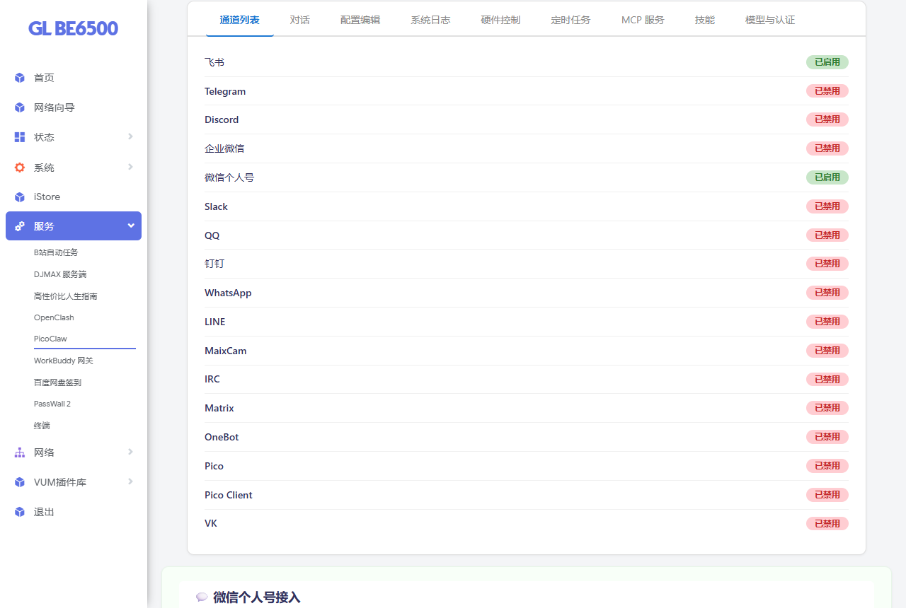
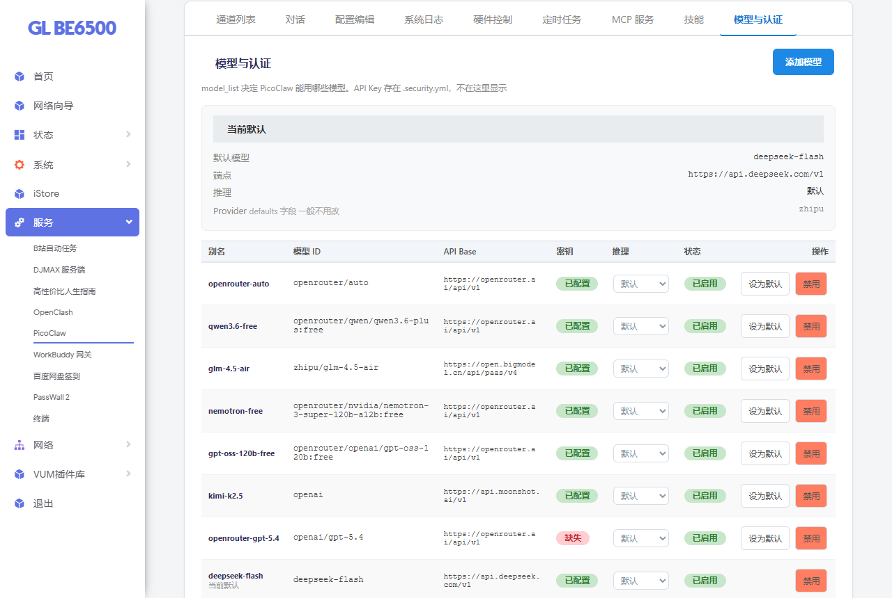
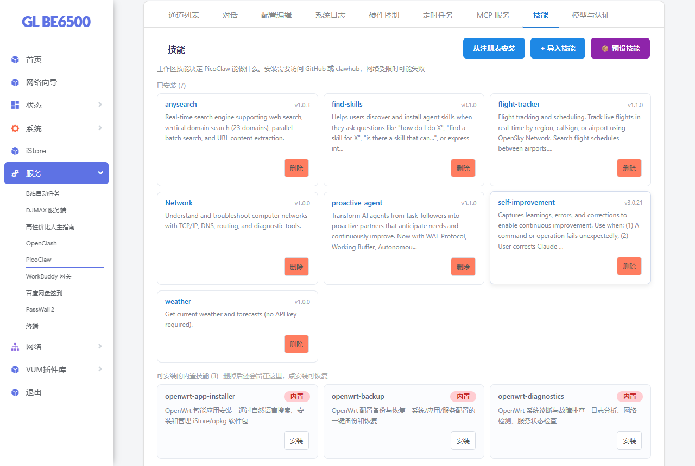
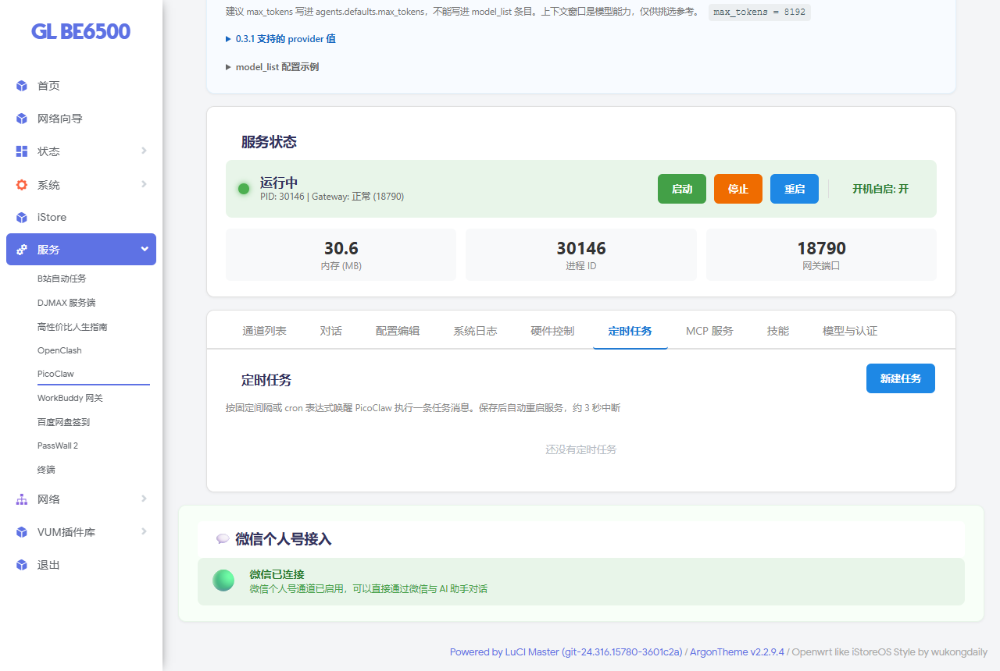

<p align="center">
  
</p>

<h1 align="center">luci-app-picoclaw</h1>

<p align="center">
  <b>Transforme seu roteador em um assistente de IA — gerencie o <a href="https://github.com/sipeed/picoclaw">PicoClaw</a> pelo navegador</b><br>
  <sub>Serviço · Canais · Modelos · Tarefas agendadas · MCP · Skills · Hardware</sub>
</p>

<p align="center">
  
  
  
</p>

<p align="center">
  <a href="README.md">English</a> ·
  <a href="README.zh.md">简体中文</a> ·
  <a href="README.ja.md">日本語</a> ·
  <a href="README.de.md">Deutsch</a> ·
  Português
</p>

---

## O que é isso?

**[PicoClaw](https://github.com/sipeed/picoclaw)** é um assistente de IA que roda **no seu roteador** — ele se conecta a modelos de linguagem (DeepSeek, GLM, Qwen, OpenAI…) e conversa com você via Feishu, Telegram, Discord, WeChat e mais.

O próprio PicoClaw não tem interface gráfica — tudo é configurado na mão em arquivos JSON. **Este plugin é essa interface**: uma página LuCI onde você gerencia serviço, modelos, canais, tarefas agendadas, servidores MCP, skills e hardware direto pelo navegador. Sem SSH, sem JSON editado à mão.

## ✨ Funcionalidades

Nove abas em uma única página:

| Aba | O que você pode fazer |
|---|---|
| **Canais** | Ver e alternar o status de Feishu / Telegram / Discord / WeChat … |
| **Chat** | Conversar com o assistente sem sair da interface do roteador |
| **Editor de Config** | Formulário guiado para `config.json`, mais modo JSON puro |
| **Logs** | Saída do PicoClaw em tempo real — erros, chamadas de LLM, uso de tokens |
| **Hardware** | Info do sistema, dispositivos USB, chaves GPIO |
| **Tarefas Agendadas** | Jobs de cron / intervalo — criar, ativar, desativar, excluir |
| **Servidores MCP** | Adicionar ou remover servidores MCP (stdio / http / sse) |
| **Skills** | Navegar, instalar, importar e excluir skills do agente |
| **Modelos e Auth** | Lista de modelos, modelo padrão, ativar/desativar, status da API key, thinking level |

Além de iniciar / parar / reiniciar o serviço com um clique, autostart, presets de busca e um editor JSON.

## 📋 Requisitos

| | Detalhes |
|---|---|
| **Sistema do Roteador** | OpenWrt 21.02+ ou iStoreOS (com interface LuCI) |
| **Binário PicoClaw** | Deve ser instalado primeiro — este plugin é apenas a interface Web, não o PicoClaw em si |
| **Arquitetura** | Qualquer uma (Lua puro, funciona em todas as arquiteturas) |

## 🚀 Instalação

### Passo 1 — Instalar o binário do PicoClaw

Este plugin é só a interface web. O PicoClaw é um programa separado — instale antes via SSH:

```bash
cd /tmp
wget https://github.com/sipeed/picoclaw/releases/download/v0.3.1/picoclaw_Linux_x86_64.tar.gz
tar xzf picoclaw_Linux_x86_64.tar.gz
cp picoclaw /usr/bin/picoclaw && chmod +x /usr/bin/picoclaw
picoclaw --version
```

> ⚠️ Esse link é para **x86_64**. Roteadores ARM (a maioria dos Xiaomi, TP-Link) precisam de `picoclaw_Linux_arm64.tar.gz` ou `picoclaw_Linux_armv7.tar.gz` — veja [PicoClaw Releases](https://github.com/sipeed/picoclaw/releases). Use `uname -m` para saber qual é o seu.

### Passo 2 — Instalar este plugin

**Opção A — iStore** (mais fácil)

Abra o iStore no roteador → busque `picoclaw` → clique em Instalar

**Opção B — IPK** (OpenWrt com `opkg`)

```bash
cd /tmp
wget https://github.com/GennKann/luci-app-picoclaw/releases/latest/download/luci-app-picoclaw_1.2.0-1_all.ipk
opkg install luci-app-picoclaw_1.2.0-1_all.ipk
rm -rf /tmp/luci-*   # limpar cache do LuCI
```

**Opção C — APK** (OpenWrt 25.x com `apk`)

```bash
cd /tmp
wget https://github.com/GennKann/luci-app-picoclaw/releases/latest/download/luci-app-picoclaw-1.2.0-r1.apk
apk add --allow-untrusted luci-app-picoclaw-1.2.0-r1.apk
rm -rf /tmp/luci-*   # limpar cache do LuCI
```

> O APK não é assinado, então `--allow-untrusted` é obrigatório.

**Compilando a partir do código**

```bash
# IPK (sistemas opkg)
python3 scripts/build-ipk.py

# APK v3 (OpenWrt 25.x / apk) — executar direto no roteador
sh scripts/build-apk-v3.sh
```

> Clones no Windows: com `core.autocrlf` ligado, o Git converte LF em CRLF. O parser Lua/HTML do LuCI só aceita LF (CRLF causa `unfinished string`), então rode `dos2unix` antes de publicar ou defina `git config core.autocrlf false`.

### Passo 3 — Abrir

`http://<IP-DO-ROTEADOR>/cgi-bin/luci/admin/services/picoclaw`

Depois adicione um modelo e uma API key — veja [Configuração de Modelo](#-configuração-de-modelo).

## 📸 Capturas de Tela

| Canais | Modelos e Auth |
|:---:|:---:|
|  |  |

| Skills | Tarefas Agendadas |
|:---:|:---:|
|  |  |

## 🤖 Configuração de Modelo

O PicoClaw precisa de uma **API key** (pense como uma senha) para pelo menos um provedor de modelo.

**Caminho mais rápido — pela interface:**

1. Abra a aba **Modelos e Auth**
2. Clique em **Adicionar modelo** e escolha um preset (DeepSeek / Zhipu GLM / Qwen / OpenAI / Anthropic / OpenRouter / Ollama) — API base e model ID já vêm preenchidos
3. Cole sua **API key**
4. Clique em **Definir como padrão** e depois **Salvar**

**Ou pelo terminal** (a chave não vai para `config.json`):

```bash
picoclaw model add -b https://api.deepseek.com/v1 -k sk-xxx -m deepseek-flash -n deepseek-flash
picoclaw model deepseek-flash        # definir como padrão
```

> 🔒 Chaves informadas pela interface vão para o `.security.yml` do PicoClaw, não para o `config.json`.

**Thinking level** — cada linha de modelo tem um dropdown (default / low / medium / high / max / adaptive) mapeado para `thinking_level`. Se isso muda mesmo a resposta depende do provedor: a DeepSeek aceita low/high/max, alguns provedores só aceitam `adaptive`, e valores sem suporte caem no padrão.

**Onde obter a key:** [Zhipu](https://open.bigmodel.cn/) · [DeepSeek](https://platform.deepseek.com/) · [OpenRouter](https://openrouter.ai/) — os três dão créditos grátis no cadastro.

## 🔍 Motor de Busca

O PicoClaw pode pesquisar na web para responder perguntas. Para usuários na China, recomendamos GLM Search ou Baidu:

| Motor | China | Observações |
|---|:---:|---|
| GLM Search | ✅ | Recomendado, funciona na China |
| Baidu | ✅ | Alternativa |
| DuckDuckGo / Brave / Tavily / Perplexity | ❌ | Bloqueado pelo GFW, funciona apenas no exterior |
| SearXNG | ⚠️ | Self-hosted, depende de onde está implantado |

## ❓ FAQ

| Pergunta | Resposta |
|---|---|
| Página não carrega após instalar? | Instale o binário PicoClaw primeiro (Passo 1) — este plugin é apenas a interface Web |
| IA diz "sem permissão para acessar a internet"? | Motor de busca bloqueado — mude para GLM Search ou Baidu |
| Não encontra no iStore? | Execute `opkg update` ou baixe o IPK do Releases |
| Campo de API key mostra `[NOT_HERE]`? | Normal — keys reais estão em `.security.yml`, gerencie pela LuCI UI |
| O que é uma API Key? | É como uma senha para chamar serviços de IA. Registre-se no site do provedor — a maioria oferece créditos grátis |
| Como verificar a arquitetura do roteador? | Conecte via SSH e execute `uname -m`. Valores comuns: x86_64, aarch64, mipsel |
| O OpenWrt 25.x recusa o IPK? | O 25.x usa `apk`, não `opkg` — baixe o `.apk` e rode `apk add --allow-untrusted` |
| Salvar a config acusa "unknown field(s)"? | O PicoClaw 0.3.1 valida `config.json` rigidamente. Use apenas `model_name`, `provider`, `model`, `api_base`, `api_keys`, `enabled`, `thinking_level` — `max_tokens` vai em `agents.defaults` |

## Registro de Mudanças

Veja [CHANGELOG.md](CHANGELOG.md).

## 📄 Licença

[Licença MIT](LICENSE)

---

Support
-------

Se você gosta deste projeto, pode dar uma estrela ao repositório ou me pagar um café :)

[](https://ko-fi.com/gennkann)

<details>
<summary>🇨🇳 WeChat Pay</summary>

</details>
