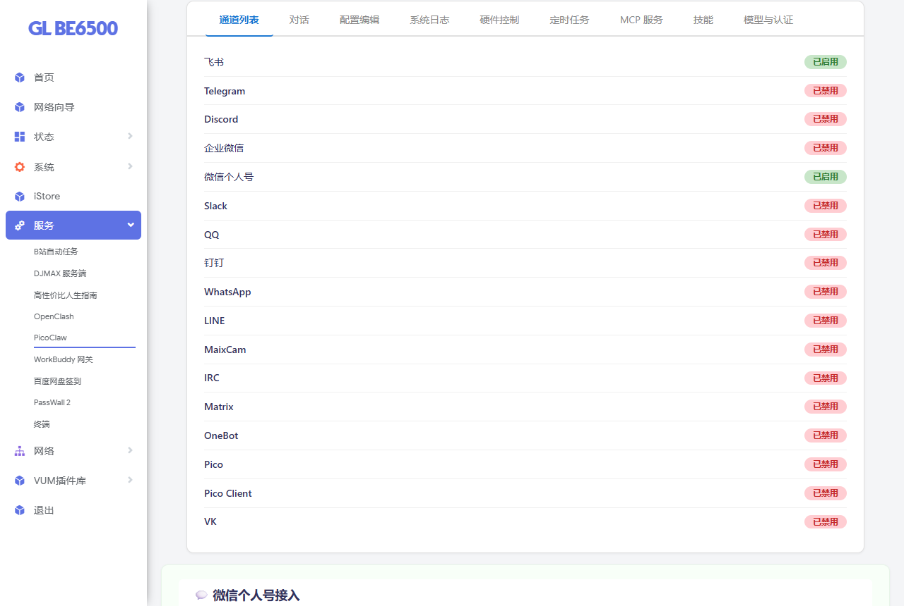
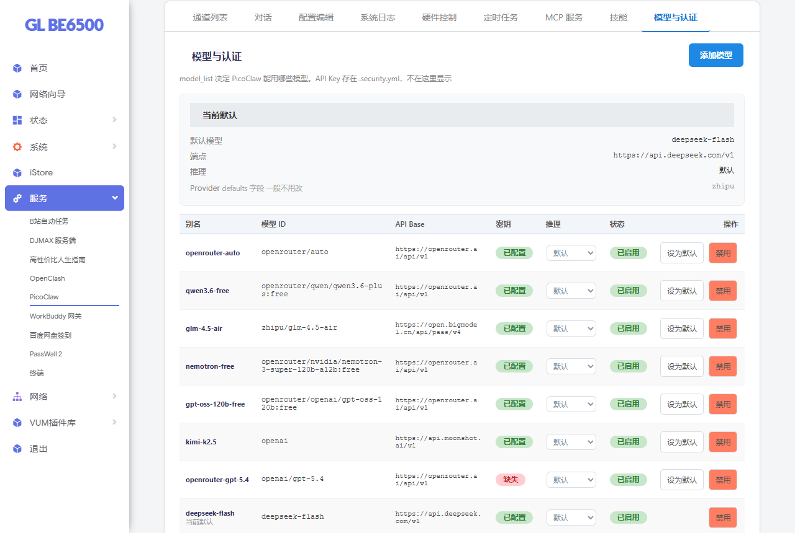
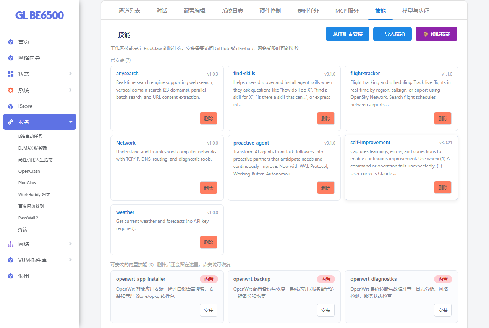
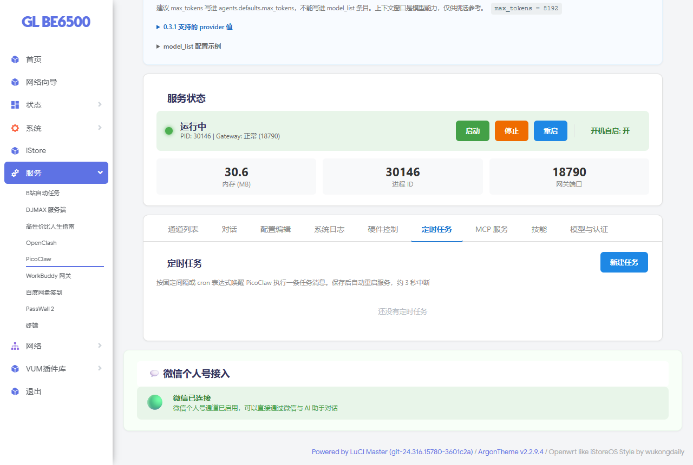

<p align="center">
  
</p>

<h1 align="center">luci-app-picoclaw</h1>

<p align="center">
  <b>让你的路由器变成 AI 助手 — 在浏览器里管理 PicoClaw</b><br>
  <sub>服务 · 通道 · 模型 · 定时任务 · MCP · 技能 · 硬件</sub>
</p>

<p align="center">
  
  
  
</p>

<p align="center">
  <a href="README.md">English</a> ·
  简体中文 ·
  <a href="README.ja.md">日本語</a> ·
  <a href="README.de.md">Deutsch</a> ·
  <a href="README.pt.md">Português</a>
</p>

---

## 这是什么？

**[PicoClaw](https://github.com/sipeed/picoclaw)** 是一个跑在**路由器上**的 AI 助手 —— 它接入大语言模型（DeepSeek、智谱 GLM、通义、OpenAI 等），然后通过飞书、Telegram、Discord、微信等通道跟你对话。

PicoClaw 本身没有图形界面，所有配置都得手改 JSON。**本项目就是它的界面** —— 一个 LuCI 页面，服务、模型、通道、定时任务、MCP 服务、技能、硬件都能在浏览器里点完，不用 SSH，也不用碰配置文件。

## ✨ 功能

一个页面，九个标签：

| 标签 | 能做什么 |
|---|---|
| **通道列表** | 查看并开关飞书 / Telegram / Discord / 微信等通道的连接状态 |
| **对话** | 不用离开路由器后台就能跟 AI 助手聊天 |
| **配置编辑** | 表单式编辑 `config.json`，另有原始 JSON 模式供高级用户折腾 |
| **系统日志** | 实时查看 PicoClaw 输出 —— 报错、LLM 调用、token 用量 |
| **硬件控制** | 系统信息、USB 设备、GPIO 开关 |
| **定时任务** | cron / 间隔任务 —— 新建、启用、禁用、删除 |
| **MCP 服务** | 增删 MCP 服务器（stdio / http / sse） |
| **技能** | 浏览、安装、导入、删除 Agent 技能 |
| **模型与认证** | 模型列表、默认模型、启停、API Key 状态、推理强度 |

另外还有一键启停 / 重启服务、开机自启、搜索引擎预设，以及给高级用户用的 JSON 编辑器。

## 📋 系统要求

| | 说明 |
|---|---|
| **路由器系统** | OpenWrt 21.02+ 或 iStoreOS（需有 LuCI 界面） |
| **PicoClaw 主程序** | 必须先安装 — 本插件只是网页管理界面，不包含 PicoClaw 本体 |
| **路由器架构** | 不限（纯 Lua，所有架构通用） |

## 🚀 安装

### 第一步：装 PicoClaw 主程序

本插件只是网页界面，PicoClaw 主程序要单独装。先 SSH 登录路由器：

```bash
cd /tmp
wget https://github.com/sipeed/picoclaw/releases/download/v0.3.1/picoclaw_Linux_x86_64.tar.gz
tar xzf picoclaw_Linux_x86_64.tar.gz
cp picoclaw /usr/bin/picoclaw && chmod +x /usr/bin/picoclaw
picoclaw --version
```

> ⚠️ 上面的链接是 **x86_64** 的。ARM 路由器（大多数小米、TP-Link）要用 `picoclaw_Linux_arm64.tar.gz` 或 `picoclaw_Linux_armv7.tar.gz`，去 [PicoClaw Releases](https://github.com/sipeed/picoclaw/releases) 对一下架构；`uname -m` 可以查。

### 第二步：装本插件

**方式一：iStore**（最简单）

路由器后台打开 iStore → 搜索 `picoclaw` → 点击安装

**方式二：IPK**（opkg 系统的 OpenWrt）

```bash
cd /tmp
wget https://github.com/GennKann/luci-app-picoclaw/releases/latest/download/luci-app-picoclaw_1.2.0-1_all.ipk
opkg install luci-app-picoclaw_1.2.0-1_all.ipk
rm -rf /tmp/luci-*   # 清除 LuCI 缓存
```

**方式三：APK**（OpenWrt 25.x 的 apk 系统）

```bash
cd /tmp
wget https://github.com/GennKann/luci-app-picoclaw/releases/latest/download/luci-app-picoclaw-1.2.0-r1.apk
apk add --allow-untrusted luci-app-picoclaw-1.2.0-r1.apk
rm -rf /tmp/luci-*   # 清除 LuCI 缓存
```

> APK 没有签名，所以必须带 `--allow-untrusted`。

**从源码构建**

```bash
# IPK（opkg 系统）
python3 scripts/build-ipk.py

# APK v3（OpenWrt 25.x 的 apk 系统）—— 在路由器上直接跑
sh scripts/build-apk-v3.sh
```

> Windows 克隆仓库时：开了 `core.autocrlf` 的话 Git 会把 LF 转成 CRLF。
> LuCI 的 Lua/HTML 解析器只吃 LF（CRLF 会报 `unfinished string`），
> 部署前请 `dos2unix`，或者设置 `git config core.autocrlf false`。

### 第三步：打开页面

`http://<路由器IP>/cgi-bin/luci/admin/services/picoclaw`

接着添加模型和 API Key —— 见[模型配置](#-模型配置)。

## 📸 截图

| 通道列表 | 模型与认证 |
|:---:|:---:|
|  |  |

| 技能 | 定时任务 |
|:---:|:---:|
|  |  |

## 🤖 模型配置

PicoClaw 至少要有一个模型供应商的 **API Key**（简单说就是密码）。

**最快的做法 —— 用界面：**

1. 打开**模型与认证**标签
2. 点**添加模型**，选一个预设（DeepSeek / 智谱 GLM / 通义 / OpenAI / Anthropic / OpenRouter / Ollama），API Base 和模型 ID 会自动填好
3. 粘贴你的 **API Key**
4. 点**设为默认**，然后**保存**

**或者用命令行**（密钥不会进 `config.json`）：

```bash
picoclaw model add -b https://api.deepseek.com/v1 -k sk-xxx -m deepseek-flash -n deepseek-flash
picoclaw model deepseek-flash        # 设为默认
```

> 🔒 界面里填的密钥会写进 PicoClaw 的 `.security.yml`，不会进 `config.json`。

**推理强度** —— 每个模型行都有下拉框（默认 / low / medium / high / max / adaptive），对应配置里的 `thinking_level`。是否真的影响回答取决于厂商：DeepSeek 认 low/high/max，有些厂商只认 `adaptive`，不支持的值会安静地回落到默认。

**API Key 去哪拿**：[智谱](https://open.bigmodel.cn/) · [DeepSeek](https://platform.deepseek.com/) · [OpenRouter](https://openrouter.ai/) —— 这三家注册都有免费额度。

## 🔍 搜索引擎

PicoClaw 可以联网搜索信息来回答问题。国内用户建议选择智谱搜索或百度：

| 引擎 | 国内可用 | 说明 |
|---|:---:|---|
| 智谱搜索 | ✅ | 推荐，国内直连 |
| 百度 | ✅ | 备选 |
| DuckDuckGo / Brave / Tavily / Perplexity | ❌ | 被 GFW 屏蔽，海外可用 |
| SearXNG | ⚠️ | 需自己搭建，取决于部署位置 |

## ❓ 常见问题

| 问题 | 解答 |
|---|---|
| 安装后页面打不开？ | 需要先安装 PicoClaw 主程序（见第一步），本插件只是管理界面 |
| AI 回复"没有权限访问网络"？ | 搜索引擎被墙了，切换为智谱搜索或百度 |
| iStore 里搜不到？ | 运行 `opkg update` 刷新软件源，或直接下载 IPK 安装 |
| API Key 那栏显示 `[NOT_HERE]`？ | 这是正常的，真实密钥存在 `.security.yml` 里，通过 LuCI 界面管理即可 |
| 不清楚什么是 API Key？ | 简单说就是你调用 AI 服务的密码，去对应供应商官网注册获取，大部分有免费额度 |
| 路由器架构怎么看？ | SSH 登录后执行 `uname -m`，常见有 x86_64、aarch64、mipsel |
| OpenWrt 25.x 装不了 IPK？ | 25.x 用的是 `apk` 不是 `opkg`，下 `.apk` 然后 `apk add --allow-untrusted` |
| 保存配置提示 "unknown field(s)"？ | PicoClaw 0.3.1 对 `config.json` 是严格校验的。只能用 `model_name`、`provider`、`model`、`api_base`、`api_keys`、`enabled`、`thinking_level`，`max_tokens` 要写在 `agents.defaults` 里 |

## 更新日志

详见 [CHANGELOG.md](CHANGELOG.md)。

## 📜 开源协议

本项目遵循 **MIT License**，可自由使用、修改与分发，但请保留作者署名。

欢迎提交 Issue / Pull Request 一起完善项目 💡

---

Support
-------

如果你喜欢这个项目，可以给仓库点个 Star，或者请我喝一杯咖啡 :)

[](https://ko-fi.com/gennkann)

<details>
<summary>🇨🇳 微信赞赏</summary>

</details>
